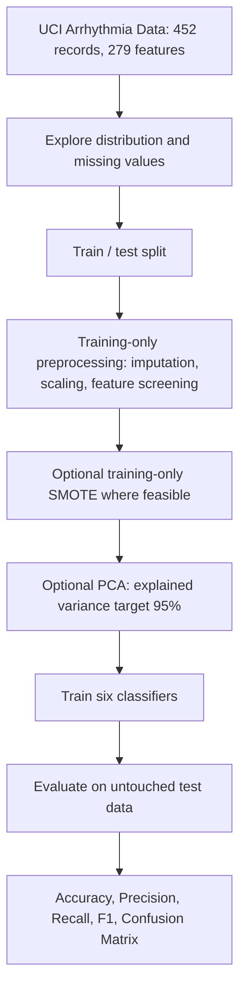

Intelligent Cardiac Disease Detection Using ECG Signals and Machine Learning

## 📌 Table of Contents

- [About the Project](#-about-he-project)
- [What is Arrhythmia?](#-what-is-arrhythmia)
- [Dataset](#-dataset)
- [Class Distribution](#-class-distribution)
- [Methodology](#️-methodology)
- [Model Performance](#-model-performance)
- [Key Findings](#-key-findings)
- [Project Structure](#-project-structure)
- [Getting Started](#-getting-started)
- [Tech Stack](#️-tech-stack)
- [References](#-references)

---

## 🔬 About the Project

An electrocardiogram (ECG) records the heart's electrical activity. This project explores machine-learning methods for differentiating normal ECG records from arrhythmia-related classes using the **UCI Arrhythmia** dataset.

The dataset presents a challenging high-dimensional classification problem: **452 patient records**, **279 input features**, missing values, and substantial class imbalance. The approach investigates preprocessing, exploratory data analysis (EDA), **Principal Component Analysis (PCA)**, and **SMOTE**-based training-set oversampling.

**Project scope:**

- Explore class distributions, missing values, feature patterns, and correlations.
- Apply missing-value imputation, feature screening, and scaling.
- Compare models with and without PCA-based dimensionality reduction.
- Explore minority-class handling with SMOTE when class counts permit.
- Train and compare six classical machine-learning classifiers.
- Evaluate accuracy, precision, recall, F1-score, and confusion matrices.

## 🫀 What is Arrhythmia?

An **arrhythmia** is an abnormal heart rhythm: the heart may beat too quickly, too slowly, or irregularly. ECG measurements can help clinicians investigate such rhythms. Some arrhythmias are benign, whereas others require medical attention.

## 📊 Dataset

| Property | Details |
|---|---|
| **Source** | [UCI Machine Learning Repository — Arrhythmia](https://archive.ics.uci.edu/dataset/5/arrhythmia) |
| **Records** | 452 |
| **Input features** | 279, including demographics and ECG-derived measurements |
| **Target** | Class codes 1–16; some classes have zero observations |
| **Missing data** | Present in several attributes, notably the J feature |
| **Main challenge** | High dimensionality and severe class imbalance |

### 📋 Class Distribution

| Code | Class | Instances |
|:---:|---|---:|
| 01 | **Normal** | 245 |
| 02 | Ischemic Changes (Coronary Artery Disease) | 44 |
| 03 | Old Anterior Myocardial Infarction | 15 |
| 04 | Old Inferior Myocardial Infarction | 15 |
| 05 | Sinus Tachycardia | 13 |
| 06 | Sinus Bradycardia | 25 |
| 07 | Ventricular Premature Contraction (PVC) | 3 |
| 08 | Supraventricular Premature Contraction | 2 |
| 09 | Left Bundle Branch Block | 9 |
| 10 | Right Bundle Branch Block | 50 |
| 11 | 1° Atrioventricular Block | 0 |
| 12 | 2° Atrioventricular Block | 0 |
| 13 | 3° Atrioventricular Block | 0 |
| 14 | Left Ventricular Hypertrophy | 4 |
| 15 | Atrial Fibrillation or Flutter | 5 |
| 16 | Others (Unclassified) | 22 |
| | **Total** | **452** |

> **Note:** The distribution above is reproduced from the supplied project documentation. Some classes contain only two or three observations, and three classes have none. Stratified splits and SMOTE may not be feasible for all labels; any filtering or class grouping must be documented.

---

## ⚙️ Methodology



**Models compared:** KNN, Logistic Regression, Decision Tree, Linear SVC, Kernelized SVC (RBF), and Random Forest.

> **Leakage prevention:** Imputation, scaling, PCA and any oversampling must be fitted only using the training set. When combining SMOTE with PCA, use a well-defined training-only pipeline; never oversample the test set.

---

## 📈 Model Performance

The following values are **historical approximate results quoted in the supplied README**, not newly verified results from the notebooks in this repository. Different evaluation splits or preprocessing choices may give different outcomes.

### Without PCA

| Model | Reported approximate accuracy |
|---|---:|
| KNN Classifier | ~65% |
| Logistic Regression | ~70% |
| Decision Tree | ~63% |
| Linear SVC | ~72% |
| Kernelized SVC | ~74% |
| Random Forest | ~73% |

### With PCA + SMOTE

| Model | Reported approximate accuracy | Notes from original documentation |
|---|---:|---|
| KNN Classifier | ~72% | Improved compared with baseline |
| Logistic Regression | ~75% | Stable across classes |
| Decision Tree | ~68% | Sensitive to overfitting |
| Linear SVC | ~76% | Good majority-class performance |
| **Kernelized SVC** | **~80.21%** | Reported as best; metric label needs verification |
| Random Forest | ~78% | Competitive baseline |

> **Metric clarification:** The supplied source describes **80.21%** both as an accuracy figure and as a *recall* score. The exact metric, split, and validation protocol have not been independently verified. Do not present it as a reproduced or clinically validated score.

---

## 🔍 Key Findings

**PCA:** With more features than may be justified by the small sample size, reducing dimensionality can mitigate correlated features and help some classifiers. The benefit should be measured on held-out data rather than assumed.

**SMOTE:** Synthetic oversampling may improve representation of minority classes when there are sufficient training examples. Extremely small classes require special handling; SMOTE cannot generate meaningful neighbors for a class with only one training sample.

**Kernelized SVM:** The original README reports an RBF SVM as its strongest model after PCA and SMOTE. Re-run experiments to verify the ranking and report macro-averaged recall and F1-score alongside accuracy.

---

## 📁 Project Structure

This is the structure of the **GitHub-ready project package**; dataset files and screenshots are not bundled unless added separately.

```text
Classification of Arrhythmia [ECG DATA]/
├── Data/
│   └── README.md                         # Dataset instructions
├── Image/
│   └── README.md                         # Information about figures
├── Model/
│   ├── original_notebook_reference.ipynb
│   └── oversampled and pca.ipynb
├── Preprocessing and EDA/
│   ├── Data preprocessing.ipynb
│   └── EDA.ipynb
├── outputs/
│   └── .gitkeep
├── final with pca.ipynb                  # Main notebook
├── requirements.txt
├── .gitignore
└── README.md
```

---

## 🚀 Getting Started

### 1. Clone the repository

```bash
git clone https://github.com/Adbhutsh/Machine-Learning-Projects.git
cd "Machine-Learning-Projects/Classification of Arrhythmia [ECG DATA]"
```

> This link assumes the repository has been created under the GitHub account `Adbhutsh` and the project folder has been pushed.

### 2. Create an environment

```bash
python -m venv .venv
```

**Linux / macOS**

```bash
source .venv/bin/activate
```

**Windows PowerShell**

```powershell
.venv\Scripts\Activate.ps1
```

### 3. Install dependencies

```bash
python -m pip install -r requirements.txt
```

### 4. Obtain the dataset

Download the [UCI Arrhythmia dataset](https://archive.ics.uci.edu/dataset/5/arrhythmia) and follow `Data/README.md` or the notebook's data-loading instructions. The original notebook may expect a file named `arrhythmia1.csv`; use the provided project workflow's expected path/format rather than silently renaming an incompatible data file.

### 5. Launch Jupyter

```bash
jupyter notebook "final with pca.ipynb"
```

Use **Run All** after confirming dependencies and the dataset configuration. Optional exploratory notebooks are located in `Preprocessing and EDA/` and `Model/`.

---

## 🛠️ Tech Stack

| Layer | Technology |
|---|---|
| Language | Python (modern supported version; e.g. 3.10+) |
| Machine learning | scikit-learn |
| Imbalance handling | imbalanced-learn (SMOTE) |
| Dimensionality reduction | PCA (scikit-learn) |
| Data processing | pandas, NumPy |
| Visualization | Matplotlib, Seaborn |
| Development | Jupyter Notebook |

---

## 📚 References

- [UCI Machine Learning Repository — Arrhythmia](https://archive.ics.uci.edu/dataset/5/arrhythmia)
- Guvenir, H. A., et al. (1997). *A Supervised Machine Learning Algorithm for Arrhythmia Analysis*. Computers in Cardiology.
- [SMOTE — imbalanced-learn documentation](https://imbalanced-learn.org/stable/references/generated/imblearn.over_sampling.SMOTE.html)
- [PCA — scikit-learn documentation](https://scikit-learn.org/stable/modules/decomposition.html#pca)

---

<div align="center">

Part of the [Machine-Learning-Projects](https://github.com/Adbhutsh/Machine-Learning-Projects) collection.

⭐ If you find the project useful, consider starring the repository.

</div>
